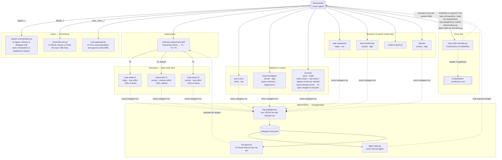
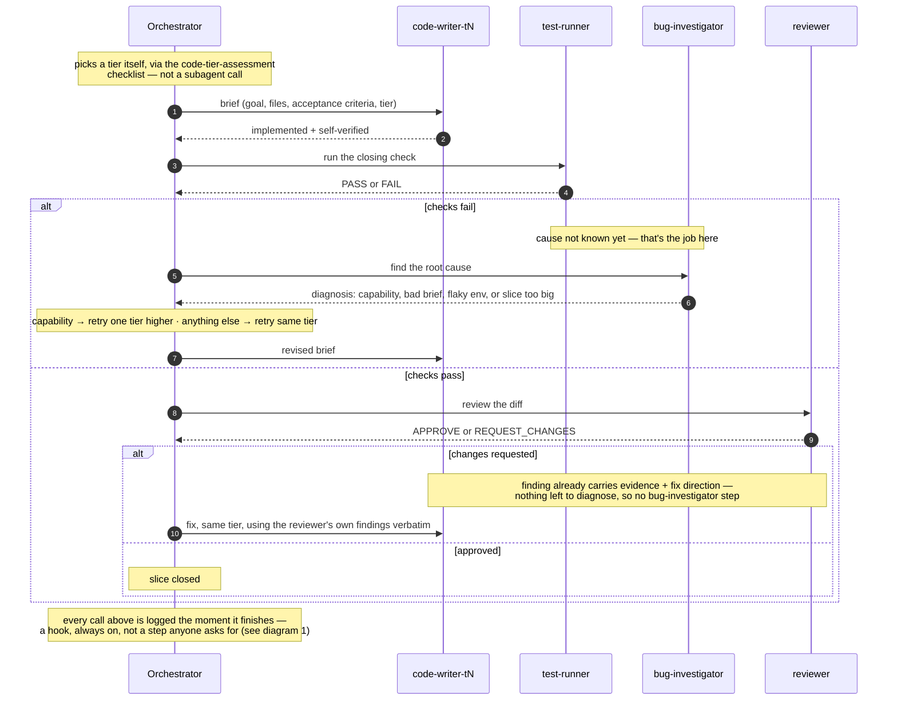

# Orchestration diagrams

Two views of the same system — see [orchestration-architecture.md](orchestration-architecture.md)
for the rationale behind each piece. Rendered as Mermaid; any editor/viewer
with Mermaid support (VS Code, GitHub, etc.) shows these as diagrams.

## 1. Static structure — roles, tiers, hooks

What exists and what watches what. Not a sequence — just the map.

## 2. Temporal flow — one slice, with escalation

Only real subagents get their own lane — a subagent is the only thing here
that actually receives a message and sends one back. `code-tier-assessment`
is a skill the orchestrator applies to itself (a checklist, no round trip),
and the logging hook fires automatically after every lane below finishes on
its own, without being asked — both are called out as notes instead of
lanes, so the diagram shows the *decisions*, not every moving part at once.

